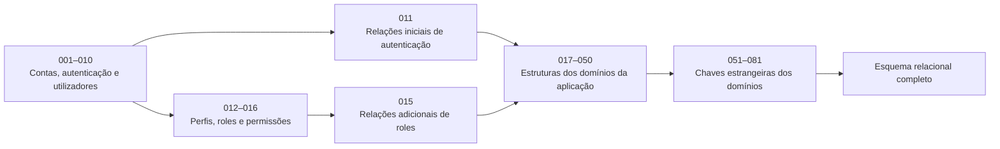
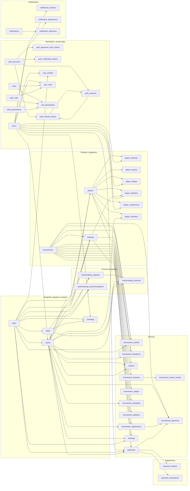

# Ciclo de vida e dependências da base de dados

> Fonte única desta documentação: ficheiros em `src/infra/database/migrations`.
> Este documento descreve o ciclo de criação do esquema e as relações persistidas declaradas pelas migrations. As migrations não definem, por si só, o fluxo HTTP nem as regras de execução da aplicação.

## Ciclo de vida do esquema

As migrations numeradas de `001` a `050` criam as tabelas. As seguintes acrescentam relações entre elas. Assim, a base evolui em duas fases: primeiro existem as estruturas; depois passam a existir as dependências por chave estrangeira.

As dependências declaradas para apagar registos são maioritariamente `RESTRICT`: a tabela referenciada não pode ser apagada enquanto existirem dependentes. Algumas relações usam `CASCADE` e outras `SET NULL`; esses casos estão discriminados nas listas abaixo.

## Diagrama geral das dependências

As setas apontam da tabela referenciada para a tabela que contém a chave estrangeira. Por exemplo, `users --> bookings` significa que `bookings.userId` depende de `users.id`.

## Relações declaradas

### Identidade e autorização

| Tabela dependente | Coluna | Referência | Ao apagar o registo referenciado |
|---|---|---|---|
| `auth_password_reset_tokens` | `authAccountId` | `auth_accounts.id` | CASCADE |
| `auth_verification_tokens` | `authAccountId` | `auth_accounts.id` | CASCADE |
| `auth_refresh_tokens` | `authAccountId` | `auth_accounts.id` | CASCADE |
| `auth_sessions` | `authAccountId` | `auth_accounts.id` | CASCADE |
| `auth_sessions` | `refreshTokenId` | `auth_refresh_tokens.id` | SET NULL |
| `auth_refresh_tokens` | `sessionId` | `auth_sessions.id` | SET NULL |
| `user_profiles` | `userId` | `users.id` | CASCADE |
| `user_profiles` | `cityId` | `cities.id` | SET NULL |
| `user_roles` | `userId` | `users.id` e `users.id` | CASCADE; migrations 011 e 015 criam constraints distintas |
| `user_roles` | `roleId` | `auth_roles.id` e `roles.id` | CASCADE; duas tabelas de destino distintas |
| `role_permissions` | `roleId` | `auth_roles.id` e `roles.id` | CASCADE; duas tabelas de destino distintas |
| `role_permissions` | `permissionId` | `auth_permissions.id` e `auth_permissions.id` | CASCADE; migrations 011 e 015 criam constraints distintas |

As migrations criam ambas `auth_roles` e `roles`, além de `auth_permissions` e `permissions`. As chaves estrangeiras de `user_roles` e `role_permissions` apontam para `auth_roles` na migration 011 e recebem relações adicionais com `roles` na migration 015. A tabela `permissions` é criada, mas estas migrations não lhe declaram uma chave estrangeira.

### Geografia, equipas, campos e reservas

| Tabela dependente | Coluna | Referência | Ao apagar o registo referenciado |
|---|---|---|---|
| `teams` | `cityId` | `cities.id` | RESTRICT |
| `teams` | `ownerId` | `users.id` | RESTRICT |
| `fields` | `cityId` | `cities.id` | RESTRICT |
| `bookings` | `userId` | `users.id` | RESTRICT |
| `bookings` | `cityId` | `cities.id` | RESTRICT |
| `bookings` | `fieldId` | `fields.id` | RESTRICT |

### Partidas e jogadores

| Tabela dependente | Coluna | Referência | Ao apagar o registo referenciado |
|---|---|---|---|
| `matches` | `homeTeamId`, `awayTeamId` | `teams.id` | RESTRICT |
| `matches` | `fieldId` | `fields.id` | RESTRICT |
| `matches` | `cityId` | `cities.id` | RESTRICT |
| `matches` | `tournamentId` | `tournaments.id` | SET NULL |
| `players` | `teamId` | `teams.id` | RESTRICT |
| `players` | `cityId` | `cities.id` | RESTRICT |
| `player_histories` | `playerId` | `players.id` | RESTRICT |
| `player_histories` | `verifiedBy` | `users.id` | SET NULL |
| `player_injuries` | `playerId` | `players.id` | RESTRICT |
| `player_ratings` | `playerId` | `players.id` | RESTRICT |
| `player_ratings` | `ratedBy` | `users.id` | RESTRICT |
| `player_ratings` | `verifiedBy` | `users.id` | SET NULL |
| `player_statistics` | `playerId` | `players.id` | RESTRICT |
| `player_statistics` | `matchId` | `matches.id` | RESTRICT |
| `player_statistics` | `verifiedBy` | `users.id` | SET NULL |
| `player_suspensions` | `playerId` | `players.id` | RESTRICT |
| `player_suspensions` | `issuedBy` | `users.id` | RESTRICT |
| `player_transfers` | `playerId` | `players.id` | RESTRICT |
| `player_transfers` | `fromTeamId`, `toTeamId` | `teams.id` | RESTRICT |

### Procura de partidas

| Tabela dependente | Coluna | Referência | Ao apagar o registo referenciado |
|---|---|---|---|
| `matchmaking_requests` | `requesterTeamId`, `candidateTeamId` | `teams.id` | RESTRICT |
| `matchmaking_requests` | `cityId` | `cities.id` | RESTRICT |
| `matchmaking_recommendations` | `teamId`, `candidateTeamId` | `teams.id` | RESTRICT |
| `matchmaking_recommendations` | `cityId` | `cities.id` | RESTRICT |
| `matchmaking_matches` | `requestId` | `matchmaking_requests.id` | RESTRICT |
| `matchmaking_matches` | `homeTeamId`, `awayTeamId` | `teams.id` | RESTRICT |
| `matchmaking_matches` | `fieldId` | `fields.id` | SET NULL |
| `matchmaking_matches` | `cityId` | `cities.id` | RESTRICT |

### Torneios e classificação

| Tabela dependente | Coluna | Referência | Ao apagar o registo referenciado |
|---|---|---|---|
| `tournament_awards` | `tournament_id` | `tournaments.id` | RESTRICT |
| `tournament_awards` | `player_id` | `players.id` | RESTRICT |
| `tournament_awards` | `team_id` | `teams.id` | RESTRICT |
| `tournament_disciplines` | `tournamentId` | `tournaments.id` | RESTRICT |
| `tournament_disciplines` | `matchId` | `matches.id` | RESTRICT |
| `tournament_disciplines` | `playerId` | `players.id` | RESTRICT |
| `tournament_disciplines` | `teamId` | `teams.id` | RESTRICT |
| `fixtures` | `tournamentId` | `tournaments.id` | RESTRICT |
| `fixtures` | `homeTeamId`, `awayTeamId` | `teams.id` | RESTRICT |
| `fixtures` | `fieldId` | `fields.id` | RESTRICT |
| `tournament_history_entries` | `historyId` | `tournament_histories.id` | CASCADE |
| `tournament_registrations` | `tournamentId` | `tournaments.id` | RESTRICT |
| `tournament_registrations` | `teamId` | `teams.id` | RESTRICT |
| `tournament_stages` | `tournament_id` | `tournaments.id` | RESTRICT |
| `tournament_standings` | `tournamentId` | `tournaments.id` | RESTRICT |
| `tournament_standings` | `teamId` | `teams.id` | RESTRICT |
| `tournament_statistics` | `tournamentId` | `tournaments.id` | RESTRICT |
| `rankings` | `teamId` | `teams.id` | RESTRICT |
| `rankings` | `tournamentId` | `tournaments.id` | RESTRICT |
| `rankings` | `cityId` | `cities.id` | RESTRICT |

### Pagamentos e notificações

| Tabela dependente | Coluna | Referência | Ao apagar o registo referenciado |
|---|---|---|---|
| `payments` | `userId`, `cityId`, `teamId` | `users.id`, `cities.id`, `teams.id` | RESTRICT |
| `payments` | `tournamentId`, `matchId` | `tournaments.id`, `matches.id` | SET NULL |
| `payment_refunds` | `paymentId` | `payments.id` | RESTRICT |
| `payment_transactions` | `paymentId` | `payments.id` | RESTRICT |
| `tournament_payments` | `tournament_id`, `team_id` | `tournaments.id`, `teams.id` | RESTRICT |
| `tournament_payments` | `registration_id`, `payment_id` | `tournament_registrations.id`, `payments.id` | SET NULL |
| `notification_deliveries` | `notification_id` | `notifications.id` | RESTRICT |
| `notification_devices` | `user_id` | `users.id` | RESTRICT |
| `notification_preferences` | `user_id` | `users.id` | RESTRICT |

`notification_templates` não recebe uma chave estrangeira nestas migrations. Também não há uma relação declarada entre `bookings` e `fields` além da FK `bookings.fieldId`, nem uma FK de `matches` para `bookings`.

## Tabelas criadas sem FK declarada nestas migrations

As migrations não declaram FKs de saída (colunas que referenciam outras tabelas) em `auth_accounts`, `auth_permissions`, `auth_roles`, `roles`, `permissions`, `cities`, `users`, `notifications`, `notification_templates`, `tournaments` e `tournament_histories`. `tournament_histories` é referenciada por `tournament_history_entries`. `users` é referenciada por várias tabelas, mas não tem uma FK declarada para `auth_accounts`.

Esta lista significa apenas que não foi encontrada uma FK nas migrations consultadas; não afirma que a aplicação não associe esses dados por outros meios.

## Observações sobre a ordem e a consistência das migrations

- A migration `011` cria as FKs de autenticação, incluindo ligações entre `auth_sessions` e `auth_refresh_tokens` em ambos os sentidos, ambas opcionais na eliminação (`SET NULL`).
- A migration `015` acrescenta FKs às mesmas colunas de `user_roles` e `role_permissions` depois de `011`. Em `user_roles.userId` e `role_permissions.permissionId`, a referência é duplicada para a mesma tabela; em `roleId`, a referência é dividida entre `auth_roles` e `roles`.
- A migration `071` altera `player_transfers.playerId` de `INTEGER` para `UUID` antes de o ligar a `players.id`.
- A migration `074` altera `tournament_disciplines.playerId` para `UUID` antes de criar essa FK.
- `tournament_histories` e `tournament_history_entries` são criadas na mesma migration (`045`); a FK de `historyId` é adicionada apenas na `076`.
- Os IDs de `players` são tratados como UUID pelas migrations `071` e `074`; outras referências de jogador devem ser lidas junto das definições de coluna das migrations correspondentes.

## Tabelas criadas

As migrations criam as seguintes 48 tabelas: `auth_accounts`, `auth_password_reset_tokens`, `auth_permissions`, `auth_refresh_tokens`, `role_permissions`, `auth_roles`, `auth_sessions`, `user_roles`, `auth_verification_tokens`, `users`, `user_profiles`, `roles`, `permissions`, `teams`, `bookings`, `cities`, `fields`, `matches`, `matchmaking_matches`, `matchmaking_recommendations`, `matchmaking_requests`, `notification_deliveries`, `notification_devices`, `notifications`, `notification_templates`, `notification_preferences`, `payments`, `payment_refunds`, `payment_transactions`, `players`, `player_histories`, `player_injuries`, `player_ratings`, `player_statistics`, `player_suspensions`, `player_transfers`, `rankings`, `tournaments`, `tournament_awards`, `tournament_disciplines`, `fixtures`, `tournament_histories`, `tournament_history_entries`, `tournament_payments`, `tournament_registrations`, `tournament_stages`, `tournament_standings` e `tournament_statistics`.
